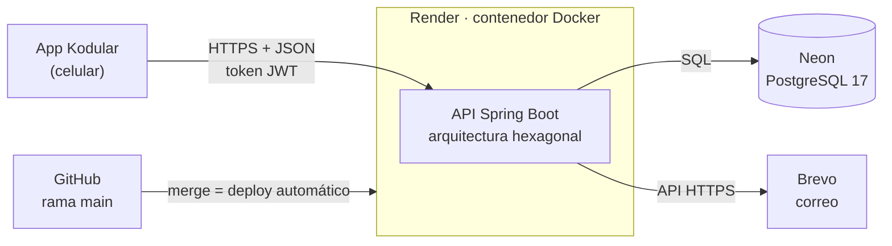

<div align="center">

# Oye! · Organize Your Expenses

**App móvil para controlar gastos, con backend REST en la nube**

Desarrollo de Apps · Corte 2 · Ejercicio 6 (Gastos)
Universidad de Cartagena · Ingeniería de Software

</div>

---

## Datos de la entrega

| | |
|---|---|
| Estudiante | Gary José Castaño Molina |
| Código | 7502420050 |
| Correo institucional | gcastanom@unicartagena.edu.co |
| Ejercicio asignado | 6 · Gastos |
| Actividad | Corte 2: Kodular con persistencia en API REST en línea y 2 sensores |
| API en producción | https://oye-api-j5l4.onrender.com |
| Documentación de la API (Swagger) | https://oye-api-j5l4.onrender.com/swagger-ui/index.html |
| APK | [`kodular/oye.apk`](kodular/oye.apk) |
| Proyecto Kodular | [`kodular/Oye.aia`](kodular/Oye.aia) |
| Videos de sustentación | [6 videos en YouTube](#videos-de-sustentación) |

> La API corre en el plan gratuito de Render: si lleva un rato sin uso, la primera petición tarda hasta un minuto mientras el servidor despierta.

---

## Videos de sustentación

La sustentación está dividida en 6 videos cortos. Se recomienda verlos en orden: cada uno explica una pieza del proyecto y el último muestra la app funcionando.

| # | Video | Enlace |
|:-:|---|---|
| 1 | De Corte 1 a Corte 2: introducción | [Ver video 1](https://youtu.be/XKE0sMTvVrU) |
| 2 | El backend: Spring Boot y arquitectura hexagonal | [Ver video 2](https://youtu.be/JxN87nfTfx8) |
| 3 | La base de datos: Neon PostgreSQL | [Ver video 3](https://youtu.be/B4bYO8_fiXM) |
| 4 | El despliegue: Docker y Render | [Ver video 4](https://youtu.be/9P4kYhaBz8M) |
| 5 | Seguridad y correo: BCrypt, JWT, roles y Brevo | [Ver video 5](https://youtu.be/cwmls7ZyKFE) |
| 6 | La app Kodular en acción | [Ver video 6](https://youtu.be/kdKobTNyDgg) |

---

## Contenido

1. [Qué es Oye!](#qué-es-oye)
2. [De Corte 1 a Corte 2](#de-corte-1-a-corte-2)
3. [Arquitectura](#arquitectura)
4. [Herramientas y por qué se eligieron](#herramientas-y-por-qué-se-eligieron)
5. [Requisitos del enunciado](#requisitos-del-enunciado)
6. [Modelo de datos](#modelo-de-datos)
7. [API REST](#api-rest)
8. [Seguridad y roles](#seguridad-y-roles)
9. [La app en Kodular](#la-app-en-kodular)
10. [Cómo instalar y probar](#cómo-instalar-y-probar)
11. [Despliegue](#despliegue)
12. [Estructura del código](#estructura-del-código)
13. [Historia del desarrollo](#historia-del-desarrollo)
14. [Créditos](#créditos)

---

## Qué es Oye!

Oye! registra los gastos de una persona y calcula el IVA (19 %) de cada uno. Cada usuario ve solo sus gastos y puede consultarlos por rango de fechas o por lugar. Un administrador gestiona los usuarios y sus roles.

Cada gasto tiene los campos del ejercicio 6: `id`, `fecha`, `valorTotalSinIva`, `ivaTotal`, `valorTotalConIva`, `nombreUsuario`, `lugar` y `descripcion`. La app solo envía cuatro de ellos (fecha, valor sin IVA, lugar y descripción); la API calcula el resto.

---

## De Corte 1 a Corte 2

En Corte 1 la app guardaba todo en el celular con TinyDB. En Corte 2 el celular solo muestra y envía datos: una API en la nube valida, calcula y guarda.

| Aspecto | Corte 1 | Corte 2 | Beneficio |
|---|---|---|---|
| Dónde viven los datos | TinyDB, dentro de cada celular | PostgreSQL en la nube (Neon) | El mismo usuario y sus gastos desde cualquier celular |
| Contraseñas | Texto plano en TinyDB | Cifradas con BCrypt | Nadie puede leerlas, ni el administrador |
| Sesión | Variable en la app | Token JWT firmado que vence a las 8 horas | Cada petición se verifica en el servidor |
| Cálculo del IVA | En los bloques de Kodular | En el dominio del backend | La regla vive en un solo lugar |
| Reportes | El celular recorría y sumaba listas | La API filtra con SQL y devuelve totales | Menos trabajo para el celular y resultados consistentes |
| Recuperar contraseña | Abría la app de correo del celular | La API envía un correo real con Brevo | Funciona aunque el usuario cambie de celular |
| Roles | Solo una pantalla distinta para el admin | ADMIN, REVIEWER y MEMBER validados en el servidor | Los permisos no se pueden saltar modificando la app |
| TinyDB | Base de datos de la app | Solo guarda la sesión (`api_url`, `sesion_token`, `sesion_usuario`) | — |

---

## Arquitectura



1. La app arma la petición (URL, encabezados con el token y cuerpo JSON) y la envía con el componente **Web** de Kodular.
2. La API valida el token y los permisos, aplica las reglas del dominio y consulta la base de datos.
3. La API responde con un código HTTP (200, 201, 204, 400, 401, 403, 404, 409) y un JSON que la app muestra.

---

## Herramientas y por qué se eligieron

| Herramienta | Para qué se usa | Por qué |
|---|---|---|
| **Kodular** | La app móvil | Es la tecnología que pide el corte; se reutilizó el diseño de Corte 1 |
| **Java 17 + Spring Boot 3.3** | El backend REST | Trae servidor web, seguridad y documentación automática; parte del repositorio base del docente |
| **Arquitectura hexagonal + DDD** | Organización del backend | Las reglas del negocio no dependen de la base de datos ni del protocolo; cada adaptador se cambia sin tocar el dominio |
| **PostgreSQL en Neon** | Base de datos en la nube | Plan gratuito sin tarjeta y sin vencimiento (la base gratuita de Render se elimina a los 30 días) |
| **JDBC + HikariCP** | Acceso a datos | SQL explícito y un pool de conexiones eficiente |
| **Docker** | Empaquetar la API | Render no ofrece Java nativo, pero sí ejecuta contenedores; además, la imagen corre igual en local y en producción |
| **Render** | Publicar la API | Gratuito, sin tarjeta y con despliegue automático en cada merge a `main` |
| **Brevo** | Enviar correos | Render bloquea los puertos SMTP en el plan gratuito; Brevo envía por su API HTTPS |
| **BCrypt** | Cifrar contraseñas | Cifrado de una vía: se compara, nunca se descifra |
| **JWT** | Sesión sin estado | El servidor verifica la firma del token en cada petición |
| **springdoc / Swagger UI** | Documentar la API | La documentación se genera desde el código y permite probar cada endpoint |
| **JUnit 5 + Mockito** | Pruebas automáticas | 335 pruebas que se ejecutan antes de cada commit |
| **Git + GitHub** | Control de versiones | Ramas por funcionalidad, Pull Requests y un commit por cambio |

---

## Requisitos del enunciado

| Requisito | Cómo se cumple |
|---|---|
| Base de datos en un servicio gratuito en internet | PostgreSQL 17 en Neon |
| CRUD de la tabla Usuario | Registro (`POST /api/auth/register` y `POST /api/users`), lista, edición de rol y estado, y eliminación en las pantallas de administrador |
| CRUD de la tabla Gastos | Crear, listar, editar y eliminar en las pantallas de gastos |
| 2 reportes parametrizados de Gastos | Por rango de fechas (`desde`, `hasta`) y por lugar |
| 2 reportes parametrizados de Usuario | Por rol y por nombre |
| Login | Con username **o** correo, y token JWT |
| Recordatorio de clave por email | Contraseña temporal enviada con Brevo |
| Tabla Usuario con username, password, nombre y email | Columnas `username`, `password`, `name` y `email` |
| Al menos 2 sensores | Ubicación (llena el lugar del gasto) y acelerómetro (agitar el celular recarga la lista) |
| Backend con arquitectura hexagonal desplegado gratis | Spring Boot hexagonal en Render |
| Repositorio público con README, código y APK | Este repositorio, con `kodular/oye.apk` y `kodular/Oye.aia` |

---

## Modelo de datos

El script completo está en [`src/main/resources/schema.sql`](src/main/resources/schema.sql).

**`users`**

| Columna | Tipo | Regla |
|---|---|---|
| `id` | VARCHAR(36) | Llave primaria (UUID) |
| `username` | VARCHAR(30) | Único, 3 a 30 caracteres (letras, números, `.`, `_`, `-`), en minúsculas |
| `name` | VARCHAR(100) | Obligatorio |
| `email` | VARCHAR(150) | Único |
| `password` | VARCHAR(255) | Hash BCrypt |
| `role` | VARCHAR(20) | `ADMIN`, `REVIEWER` o `MEMBER` (restricción CHECK) |
| `status` | VARCHAR(20) | `ACTIVE`, `INACTIVE`, `PENDING` o `BLOCKED` (restricción CHECK) |

**`gastos`**

| Columna | Tipo | Regla |
|---|---|---|
| `id` | VARCHAR(36) | Llave primaria (UUID) |
| `user_id` | VARCHAR(36) | Llave foránea a `users`; al borrar el usuario se borran sus gastos |
| `fecha` | DATE | Obligatoria |
| `valor_total_sin_iva` | NUMERIC(14,2) | No negativo |
| `iva_total` | NUMERIC(14,2) | 19 % del valor sin IVA, calculado por la API |
| `valor_total_con_iva` | NUMERIC(14,2) | Suma de los dos anteriores (restricción `chk_gastos_total`) |
| `lugar` | VARCHAR(100) | Obligatorio |
| `descripcion` | VARCHAR(255) | Obligatoria |

`nombreUsuario` no se guarda en `gastos`: la API lo obtiene uniendo `gastos` con `users`.

---

## API REST

Todas las rutas, salvo las de `/api/auth`, exigen el encabezado `Authorization: Bearer <token>`.

| Método | Ruta | Quién | Para qué |
|---|---|---|---|
| POST | `/api/auth/login` | Público | Iniciar sesión con `usuario` (username o correo) y `password` |
| POST | `/api/auth/register` | Público | Registrarse (queda como MEMBER activo) |
| POST | `/api/auth/forgot-password` | Público | Recibir una contraseña temporal por correo (responde 204 siempre) |
| GET / PUT / DELETE | `/api/users/me` | Usuario autenticado | Ver, editar o eliminar el propio perfil |
| POST | `/api/users` | ADMIN | Crear un usuario con cualquier rol |
| GET | `/api/users`, `/api/users/{id}` | ADMIN, REVIEWER | Listar o consultar usuarios |
| PUT | `/api/users/{id}` | ADMIN | Editar un usuario (rol, estado, datos) |
| DELETE | `/api/users/{id}` | ADMIN | Eliminar un usuario |
| GET | `/api/users/reports?role=&name=` | ADMIN, REVIEWER | Reportes de usuarios por rol o por nombre |
| POST | `/api/gastos` | Usuario autenticado | Registrar un gasto (el dueño sale del token) |
| GET | `/api/gastos`, `/api/gastos/{id}` | Usuario autenticado | Listar o consultar gastos |
| PUT | `/api/gastos/{id}` | Dueño o ADMIN | Editar un gasto |
| DELETE | `/api/gastos/{id}` | Dueño o ADMIN | Eliminar un gasto |
| GET | `/api/gastos/reports?desde=&hasta=&lugar=` | Usuario autenticado | Reportes de gastos con cantidad y totales |

Ejemplo: registrar un gasto.

```http
POST /api/gastos
Authorization: Bearer eyJhbGciOi...
Content-Type: application/json

{ "fecha": "2026-11-03", "valorTotalSinIva": 10000, "lugar": "Exito San Diego", "descripcion": "Mercado" }
```

```json
{ "id": "7f3a…", "fecha": "2026-11-03", "valorTotalSinIva": 10000.00, "ivaTotal": 1900.00,
  "valorTotalConIva": 11900.00, "usuarioId": "…", "nombreUsuario": "Prueba Video",
  "lugar": "Exito San Diego", "descripcion": "Mercado" }
```

---

## Seguridad y roles

- **Contraseñas:** se guardan con BCrypt.
- **Token:** el login devuelve un JWT firmado que vence a las 8 horas. Sin token, o con un token alterado o vencido, la API responde 401.
- **Dueño del gasto:** sale del token, nunca del cuerpo de la petición.
- **Recuperación de clave:** la API responde igual exista o no el correo, para no revelar quién está registrado.
- **Secretos:** la conexión a la base de datos, la llave de Brevo y el secreto JWT se definen como variables de entorno en Render; nunca están en el repositorio.

| Rol | Gastos | Usuarios |
|---|---|---|
| MEMBER | Solo los propios: crear, ver, editar, eliminar | Su propio perfil |
| REVIEWER | Ve todos; modifica solo los propios | Consulta y reportes |
| ADMIN | Ve y modifica todos | CRUD completo y reportes |

---

## La app en Kodular

Cada pantalla sigue el mismo patrón: arma la URL, agrega los encabezados con el procedimiento `encabezados` (tipo JSON y token), envía con el componente **Web** y en `GotText` revisa el código de respuesta y lee el JSON con `JSON Text Decode` y `look up in pairs`.

| Pantalla | Rol | Función | Petición |
|---|---|---|---|
| Screen1 | Todos | Splash; guarda `api_url` y despierta el servidor | `GET /v3/api-docs` |
| Screen2 | Todos | Login y recuperación de contraseña | `POST /api/auth/login`, `POST /api/auth/forgot-password` |
| Screen3 | Todos | Registro | `POST /api/auth/register` |
| Screen4 | MEMBER | Menú del usuario | — |
| Screen5 | ADMIN | Menú del administrador | — |
| Screen6 | MEMBER | Formulario de gasto: crear y editar, con vista previa del IVA | `POST`, `GET /{id}`, `PUT /{id}` en `/api/gastos` |
| Screen7 | MEMBER | Lista de gastos: editar y eliminar | `GET`, `DELETE /{id}` en `/api/gastos` |
| Screen8 | MEMBER | Mi perfil: ver y editar usuario, nombre, correo y contraseña; eliminar la cuenta | `GET`, `PUT`, `DELETE` en `/api/users/me` |
| Screen9 | MEMBER | Reporte de gastos por fechas | `GET /api/gastos/reports?desde=&hasta=` |
| Screen10 | MEMBER | Reporte de gastos por lugar | `GET /api/gastos/reports?lugar=` |
| Screen11 | ADMIN | Usuarios: listar, editar rol o estado, eliminar | `GET`, `PUT /{id}`, `DELETE /{id}` en `/api/users` |
| Screen12 | ADMIN | Reporte de usuarios por rol | `GET /api/users/reports?role=` |
| Screen13 | ADMIN | Reporte de usuarios por nombre | `GET /api/users/reports?name=` |

**Sensores**

- **Ubicación** (Screen6): al crear un gasto, llena el campo lugar con la dirección actual una sola vez y luego se apaga, para no reemplazar lo que el usuario escriba.
- **Acelerómetro** (Screen7): al agitar el celular, la lista de gastos se recarga desde el servidor.

---

## Cómo instalar y probar

### Opción 1: la app (recomendada)

1. Descargue [`kodular/oye.apk`](kodular/oye.apk) en un celular Android y ábralo. Si Android lo pide, permita instalar apps de orígenes desconocidos.
2. Permita el acceso a la ubicación.
3. En el login, toque **Registrarse** y cree una cuenta (queda como MEMBER).
4. Inicie sesión con su username o correo y pruebe: nuevo gasto, lista de gastos (agite el celular para recargar), editar, eliminar, los dos reportes y el perfil.

Para probar las pantallas de administrador, solicite una cuenta ADMIN al autor.

### Opción 2: la API desde el navegador

1. Abra https://oye-api-j5l4.onrender.com/swagger-ui/index.html (espere si el servidor está despertando).
2. Use `POST /api/auth/register` y luego `POST /api/auth/login`.
3. Copie el `accessToken` de la respuesta, pulse **Authorize** y péguelo.
4. Pruebe los endpoints de gastos y reportes.

### Opción 3: correr el backend en local con Docker

Requisitos: Docker Desktop y Git.

```bash
git clone https://github.com/gary-castano-m/users-management-spring-boot-hexagonal-ddd.git
cd users-management-spring-boot-hexagonal-ddd
cp .env.example .env        # en Windows: copy .env.example .env
docker compose up --build -d
```

- API: http://localhost:8080 · Swagger: http://localhost:8080/swagger-ui/index.html
- PostgreSQL se crea en un contenedor y `schema.sql` se ejecuta automáticamente la primera vez.
- Para enviar correos en local, complete las variables de Brevo en `.env`.

### Opción 4: compilar y ejecutar las pruebas

Requisito: JDK 17 o superior.

```bash
./mvnw clean package        # en Windows: mvnw.cmd clean package
```

Resultado esperado: `Tests run: 335, Failures: 0, Errors: 0` y `BUILD SUCCESS`.

### Abrir el proyecto de Kodular

En [creator.kodular.io](https://creator.kodular.io): **Project → Import project (.aia) from my computer** → seleccione [`kodular/Oye.aia`](kodular/Oye.aia).

---

## Despliegue

| Pieza | Servicio | Configuración |
|---|---|---|
| API | Render (Web Service, Docker, plan gratuito, región Ohio) | Se construye con el `Dockerfile` en cada merge a `main` |
| Base de datos | Neon (PostgreSQL 17, rama `production`, base `neondb`) | Esquema creado con `schema.sql` |
| Correo | Brevo (API HTTP v3) | Remitente verificado con el correo institucional |

Variables de entorno de Render (valores no publicados; plantilla en [`.env.example`](.env.example)):

| Variable | Uso |
|---|---|
| `DB_HOST`, `DB_PORT`, `DB_NAME`, `DB_USERNAME`, `DB_PASSWORD` | Conexión a Neon |
| `JWT_SECRET`, `JWT_EXPIRATION_SECONDS` | Firma y duración del token (28800 s = 8 h) |
| `EMAIL_PROVIDER` | `brevo` en producción |
| `BREVO_API_KEY`, `BREVO_SENDER_EMAIL`, `BREVO_SENDER_NAME` | Envío de correos |

El `Dockerfile` tiene dos etapas: Maven compila el `.jar` y una imagen con solo Java 17 (JRE) lo ejecuta con un usuario sin privilegios.

---

## Estructura del código

```text
src/main/java/com/jcaa/usersmanagement/
├── domain/                  Reglas del negocio, sin dependencias externas
│   ├── model/               UserModel, GastoModel
│   ├── valueobject/         UserEmail, UserUsername, UserPassword, Dinero…
│   └── exception/           Errores del dominio
├── application/             Casos de uso
│   ├── port/in/             Lo que la aplicación ofrece (use cases)
│   ├── port/out/            Lo que la aplicación necesita (guardar, buscar, enviar correo)
│   └── service/             Implementación de los casos de uso
└── infrastructure/          Adaptadores
    ├── adapter/persistence/ PostgreSQL con JDBC
    ├── adapter/email/       Brevo y SMTP
    ├── entrypoint/rest/     Controladores REST, DTO y manejo de errores
    └── security/            JWT y configuración de Spring Security
kodular/                     Proyecto .aia y APK de la app
```

Ejemplo del flujo de **registrar un gasto**: `GastoRestController` → `RegistrarGastoService` → `GastoModel` (calcula el IVA con `Dinero`) → puerto `SaveGastoPort` → `GastoRepositoryPostgres`.

---

## Historia del desarrollo

El proyecto parte del repositorio base del docente (Spring Boot hexagonal con JWT). Cada funcionalidad se desarrolló en su propia rama y se integró con un Pull Request; los commits siguen el formato `tipo(alcance): descripcion`.

| PR | Rama | Qué agregó |
|---|---|---|
| #1 | `feature/postgresql-migration` | Migración de la base de datos a PostgreSQL |
| #2 | `chore/docker-setup` | Dockerfile, docker-compose y despliegue en Render |
| #3 | `feature/brevo-email-adapter` | Envío de correos con Brevo |
| #4 | `feature/user-registration` | Registro público de usuarios |
| #5 | `feature/login-user-data` | Datos del usuario en la respuesta del login |
| #6 | `feature/self-profile` | Perfil propio (`/api/users/me`) |
| #7 | `feature/user-reports` | Reportes de usuarios por rol y nombre |
| #8 | `feature/password-recovery` | Recuperación de contraseña por correo |
| #9 | `feature/gastos-domain` | Dominio de Gastos (IVA, `Dinero`) |
| #10 | `feature/gastos-persistence` | Tabla y repositorio de Gastos |
| #11 | `feature/gastos-application` | Casos de uso y permisos de Gastos |
| #12 | `feature/gastos-rest` | Endpoints y reportes de Gastos |
| #13 | `feature/username` | Campo username y login con username o correo |

---

## Créditos

- **Autor:** Gary José Castaño Molina · gcastanom@unicartagena.edu.co
- **Repositorio base:** [arrietajohn/users-management-spring-boot-hexagonal-ddd](https://github.com/arrietajohn/users-management-spring-boot-hexagonal-ddd), del docente John Carlos Arrieta Arrieta.
- **Licencia:** ver [`LICENSE`](LICENSE).
